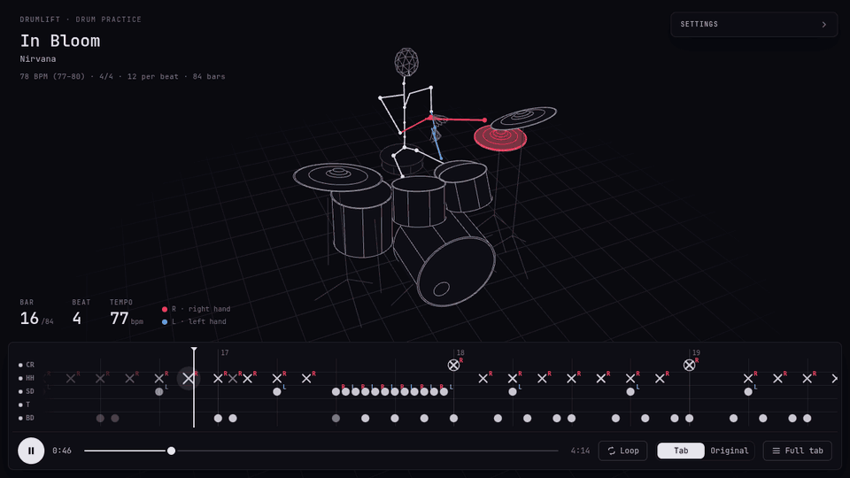

# drumlift

Song in, drum tab out, played back in time with the recording so you can check it by ear.



```
song ──► Demucs ──► isolated drums ──► ADTOF ──► notes (kick, snare, hi-hat, tom, cymbal)
  │                                                       │
  └──► beat_this ──► beats + downbeats ──► grid ──► tab.txt / drums.mid / player
```

The grid follows the real beats, so the tab stays in place when the band speeds up or drags.
Each beat is quantized as straight or triplet on its own.

## Install

Needs [uv](https://docs.astral.sh/uv/) and `ffmpeg`. The first run downloads the models (~160 MB).

```sh
uv sync
```

## Use

```sh
uv run drumlift run "song.mp3"                # process and open the player
uv run drumlift play out/song                 # open it again
uv run drumlift retab out/song --sens 1.3     # redo only the tab, in seconds
```

A 4-minute song takes 2 to 3 minutes on a CPU. It also accepts a link if `yt-dlp` is installed.

| option | |
|---|---|
| `--grid auto\|4\|3\|6\|8\|2` | divisions per beat (default `auto`) |
| `--sens 1.3` | catch weaker notes; `0.8` keeps only strong ones |
| `--from mix` | transcribe the full mix instead of the isolated drums |
| `--model htdemucs_ft` | better separation, 4x slower (`run` only) |
| `--kit dir/` | your own samples in the player |
| `--no-play` | don't open the player |

## Output

| file | |
|---|---|
| `tab.txt` | text tab |
| `drums.mid` | MIDI with a tempo map, for MuseScore, Guitar Pro or Reaper |
| `drums.wav`, `no_drums.wav` | isolated drums, band without drums |
| `tab_synth.wav`, `tab_with_band.wav` | the tab alone, the tab with the band |
| `song.json` | everything the player reads |

## Player

A motion capture drummer plays the tab with the song. Red is the right hand and blue the left, worked
out by rules, and each piece lights up in the color of the limb that hit it.
Toggle tab and original with `A`, mute a piece by clicking its name, loop with `L`, slow down
with `[` and `]`, and fix notes in the full tab with `T`. Details in [`docs/stage.md`](docs/stage.md).

## Accuracy

Notes written in the right place (F1) against reference tabs of 6 songs: 75% to 99%.
Bars identical to the reference: 1% to 88%. Most of what's left comes from the model:

- ADTOF knows 5 classes, so open and closed hi-hat look the same, there's no pedal hi-hat,
  and all toms share one line. Crash or ride is a heuristic.
- Notes faster than the grid merge into one.
- One time signature per song.

`tools/bench.py` measures this; reference tabs aren't in the repo.
Synthetic songs with known answers are in `tests/` (`make_test_song.py`, `score.py`).

## License

The code is MIT. Dependencies have their own terms:

- **ADTOF model**, downloaded on install: CC BY-NC-SA 4.0, **non-commercial only**
  ([ADTOF](https://github.com/MZehren/ADTOF), [ADTOF-pytorch](https://github.com/xavriley/ADTOF-pytorch)).
  It does the transcription, so this applies to anyone using the project.
- **Demucs**, **beat_this**, **Three.js**, **fflate**: MIT.
- **Stroke library**, optional and not in the repo: built from [MMIP](https://mmip.cs.ucy.ac.cy),
  CC BY-NC-SA 4.0, **non-commercial only**.
